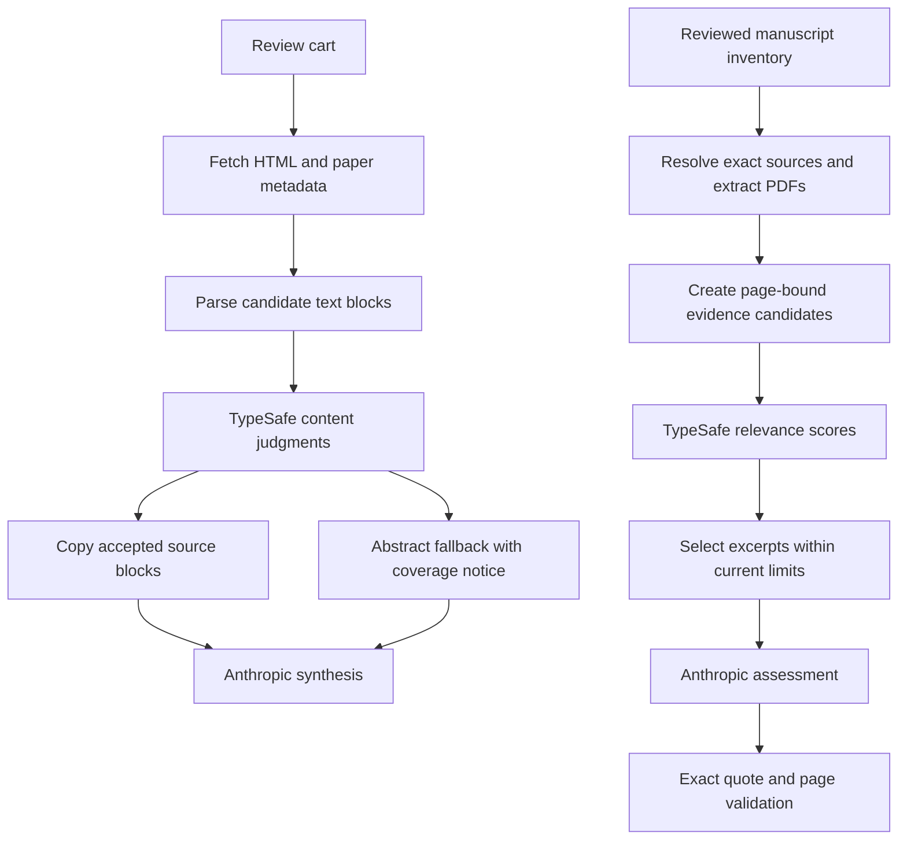

# TypeSafe workflow integration plan

Implementation status: the server adapter, HTML parser/quality gate, audit reranker, fallback handling, configuration, and diagnostics below are now implemented behind default-off feature modes. A synthetic live smoke check passed and the test suite covers the integration. Real-document calibration and broad rollout remain pending; final verdict replacement remains an evaluation task. The accompanying REPORT.md records the experiments supporting the proposed order.

## Intended behavior

Review generation should use scholarly evidence rather than accept any long HTML page. Manuscript audits should select evidence that addresses the actual claim, including contrary findings, before asking Anthropic for an assessment. Users retain the existing Generate Review and Check Manuscript actions.

## 1. Shared server-side TypeSafe adapter

Add `lib/models/typesafeClient.js`, created and injected through `lib/setup.js`. Use the documented HTTP interface or an official SDK after checking its current contract. The prototype proves the HTTP shape; it is not production client code.

Configuration to add to `.env.example` and README:

- `TYPESAFE_API_KEY`: server environment only.
- `TYPESAFE_MODEL=jev-1.13.0`: pin the evaluated version.
- `TYPESAFE_REVIEW_MODE=off|shadow|on` and `TYPESAFE_AUDIT_MODE=off|shadow|on`: start off; deploy shadow before on.

Expose `evaluate({state, questions, signal})`. Validate expected answer IDs, primitive types, finite scores and probabilities, allowed choice labels, and bounds. Record actual returned model and rubric version. Set a bounded request timeout, honor Retry-After for retryable errors, and limit total retry time. Start with a 10-second total TypeSafe deadline per user operation and at most two concurrent requests; treat those as tunable operating defaults, not benchmark findings. Abort remaining calls when the request is cancelled or deadline expires.

Cache judgments in the existing in-memory TTL style. Key by content hash, normalized claim or expected paper identity, model, rubric version, and relevant candidate boundaries. Scope private manuscript cache entries consistently with existing audit access. Never log raw manuscript text or secrets by default. Record request count, input tokens, elapsed time, fallback reason, and selection IDs.

## 2. Review HTML gate — first production slice

Change `lib/review/reviewEvidence.js` and inject the adapter from `lib/review/reviewService.js`.

1. Separate candidate extraction from evidence acceptance. Use a standard HTML parser to enumerate meaningful content regions and paragraph blocks, retaining document order and neighboring context. Remove executable/style/navigation structures deterministically. Avoid choosing only the first `article` and avoid discarding all text under 150 characters before evaluation.
2. Bound fetched and parsed content. Process candidate groups within the documented state/question token limits, reserving space for metadata and rubric. Do not assume a character limit equals a token limit. Prioritize likely scholarly regions but record truncation; empty or inaccessible content remains unavailable.
3. Send title, authors, year, and candidate blocks as state. Ask one Choice per candidate group using the tested usable/unusable rubric. Each question names its exact candidate field. Same-state questions can run together; they must not depend on one another's answers.
4. Copy accepted blocks from the parser's source text, in source order, deduplicating overlapping regions. Retain the 12,000-character per-paper output cap. A whole-region usable verdict does not clean embedded boilerplate; block selection and deterministic cleanup must do that work.
5. Gate automatic acceptance using a confidence threshold selected on a separate calibration set. Keep the gate in shadow mode until that threshold is established. Low-confidence, rejected, missing, malformed, or timed-out judgments use the abstract fallback when mode is on, with a clear coverage warning. If there is no abstract either, report no usable evidence.
6. Preserve the existing `abstract_only` / `html_plus_abstract` response contract. The latter means retained HTML content, not verified full-text coverage. Include a diagnostic quality field for exports/logging, and only surface a user notice when evidence is missing, uncertain, or reduced.

Off mode uses the existing behavior. Shadow mode computes judgments without changing selected text; on mode uses only accepted content. Cache keys for **both evidence and synthesized reviews** must include mode, model/rubric version, and an evidence fingerprint so old cached results cannot bypass the gate. Avoid caching temporary failure fallbacks for the same duration as successful evidence.

This phase also requires meaningful parser tests: short findings, nested HTML, two articles with an access panel first, boilerplate mixed with a real abstract, wrong-paper metadata, and research discussing cookies/CAPTCHAs. The oracle probe is not a substitute for these tests.

## 3. Audit passage reranking — second slice

Refactor `selectPassages` in `lib/audit/auditService.js` into candidate generation and selection, keeping a deterministic fallback. Add an injected asynchronous ranker between source resolution and packet construction.

1. Preserve page number, source SHA-256, exact normalized text, start/end offsets, and adjacent context for each candidate. Keep the existing 1,800-character windows / 1,400-character stride initially, then test sentence-aware boundaries separately.
2. For a small document, score every candidate in bounded groups. For a large document, use a measured-recall shortlist combining lexical candidates with coverage across pages/sections. Do not feed only the old top eight. The experiment showed that this would eliminate the useful evidence before reranking.
3. Ask the tested four-level relevance Score per claim/candidate, including support, contradiction, and scope limitations. Use the same rubric across batches. Keep raw scores; confidence reflects uncertainty, not scientific correctness.
4. Sort by relevance, then stable source position. Deduplicate overlapping spans before packing at most eight excerpts / 14,000 characters. Preserve exact page-bound source text. Do not require positive support to retain an excerpt.
5. If ranking fails, times out, or has no usable scores, use current `selectPassages` and include a selection warning. Do not interpret API failure or low relevance as a contradiction. When candidates were truncated, record the coverage limitation.
6. Keep Anthropic's existing assessment, suggested revision, and combined-source reasoning. Run `validateAssessment` unchanged in responsibility: exact quote/page anchoring, unavailable-source handling, and conservative combined findings remain mandatory.

In `createAuditService`, await the ranker for each available source and pass the operation's remaining deadline. Stop/Resume retains its current behavior, with cancellation propagated where supported. Cache rankings by source hash, claim, candidate-generation version, model, and rubric.

Add selection diagnostics to JSON exports through `frontend/src/audit/auditState.js`; preserve existing reports and show only concise fallback/coverage notices in `frontend/src/audit/manuscriptAudit.js`. Add TypeSafe readiness separately to status; missing TypeSafe must not falsely mark Anthropic extraction as unconfigured. Update the data-flow notice to say selected passages/claims may also be sent to TypeSafe when the corresponding mode is active, including shadow mode.

## 4. Citation verdicts — shadow evaluation only

The 16/16 result is promising but insufficient for replacing assessment. Label boundaries such as partial support versus insufficient evidence need independent adjudication. The experiment did not test extracting quotes, generating explanations, identifying bibliographic sources, or combining multiple sources.

Evaluate a narrow claim/evidence Choice in parallel with the existing model only on evidence that passed deterministic provenance checks. Store disagreements and distributions. Do not let TypeSafe turn a rejected quote or missing PDF into verified support. Explanations and revisions still need generation or explicit templates; Choice does not produce them.

Defer automatic verdict replacement, fuzzy source resolution, and graph ranking to separate proposals supported by their own data. Keep exact DOI/arXiv/version matching, access controls, hashes, and literal quote matching in code.

## 5. Evaluation and rollout gates

Build a manually reviewed corpus of at least 100 real HTML pages across supported source hosts and at least 50 claim/source pairs from multiple papers, with permission to send any private material. Split by paper/host family into development, threshold calibration, and untouched evaluation sets; do not use the synthetic cases to claim generalization. Independently review disputed labels, especially multi-clause claims and causal scope.

For HTML, measure precision of retained evidence, recall of useful content, wrong-paper acceptance, and end-to-end evidence coverage. For audit ranking, measure candidate discovery recall separately from selection recall@8, contradictory-evidence retention, page diversity, and final verdict changes. Compare the existing heuristic with both a parser-only improvement and parser plus TypeSafe so the AI contribution is visible.

Proposed release criteria (targets, not achieved results):

- HTML: at least 95% precision on accepted content, improved useful-content recall, and no known parser regression in the evaluation set. Report sample counts and uncertainty; zero observed false accepts is not proof of zero risk.
- Audit: improved recall@8 on paraphrases and contrary findings, no regression on direct-match controls, and no source-text/page corruption.
- Both: zero provenance-invariant failures, graceful timeout/auth/rate-limit handling, and measured p95 added latency below two seconds per typical operation. If the latency target is missed, keep the affected feature in shadow mode and tune batching/caching.
- Test disabled, shadow, enabled, and missing-key paths under both Express and Vercel shared setup. Retain the current audit access protection.

Implement adapter → HTML parser/gate → shadow evaluation → calibrated HTML rollout → audit ranker/shadow evaluation → audit rollout. Each feature flag provides immediate rollback. Record usage and latency at operation level; the roughly 0.17-second small-request measurements do not predict the cost or latency of scoring a long PDF or ten-paper cart.

## Implementation deliverables

1. Adapter, configuration, bounded retry/cancellation, and mocked transport checks.
2. Parser candidate extraction, review quality gate, coverage diagnostics, and cache invalidation.
3. Page-bound audit candidate builder, score/pack/fallback workflow, and export diagnostics.
4. Real-data evaluation report with calibrated thresholds and feature-specific rollout decision.

Existing application edits in the working tree should be preserved. The experimental harness can seed regression fixtures but should remain separate from production request handling.
